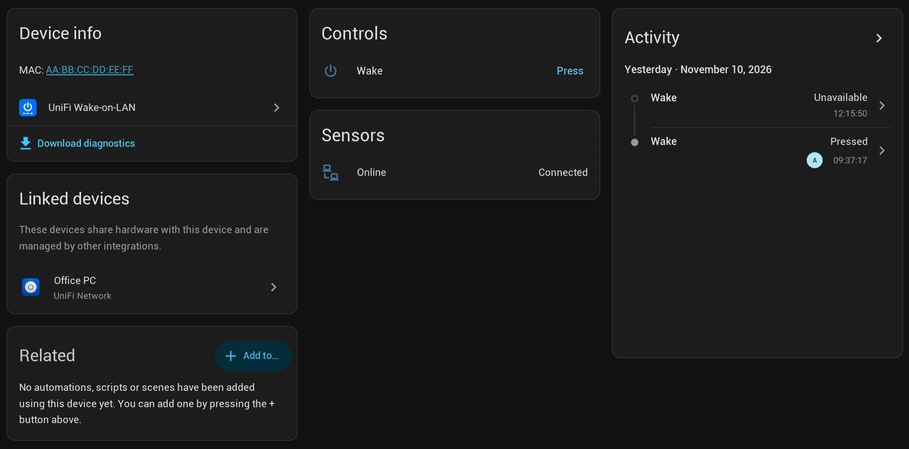
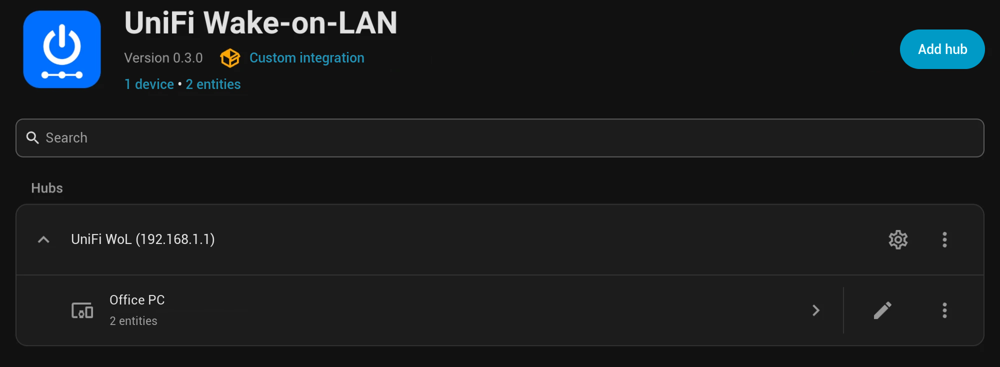

# UniFi Wake-on-LAN für Home Assistant

*English: [README.md](README.md)*

Fragen, Feedback oder ein anderes Gateway? Zur [Diskussion in der Home Assistant Community](https://community.home-assistant.io/t/unifi-wake-on-lan-wake-clients-on-any-vlan-through-your-unifi-gateway/1033912) (Englisch).

Weckt Clients **in jedem VLAN** auf: Das Magic Packet wird nicht von Home Assistant gesendet, sondern vom UniFi-Gateway (getestet mit einem UCG Fiber, gedacht für alle UniFi-OS-Gateways wie UCG Ultra/Max oder UDM) direkt auf dem Interface des Netzwerks, in dem der Client zuletzt war.





## Wie es funktioniert

1. Über die UniFi-Network-API (nur lesend) holt die Integration Clients (aktiv + Historie) und Netzwerke (Subnetz/VLAN).
2. Beim Drücken des Buttons verbindet sie sich per SSH mit dem Gateway, liest `ip -o -4 addr show` und bestimmt das passende Interface (z. B. `br20` für VLAN 20).
3. Dort wird das Paket gesendet, je nachdem, was auf dem Gateway verfügbar ist:
   `etherwake` → `ether-wake` → `busybox ether-wake` → `python3` (Raw-Ethernet-Frame, EtherType 0x0842) → Fallback: temporärer statischer ARP-Eintrag + UDP-Paket an Port 9 per `bash` (der Eintrag wird direkt wieder entfernt).

Die UniFi-API selbst kennt keinen Wake-on-LAN-Befehl, deshalb ist SSH nötig.

## Installation

**HACS:** `https://github.com/chriscomputerfreak/unifi-wake-on-lan` als *Custom Repository* (Typ *Integration*) hinzufügen, **UniFi Wake-on-LAN** installieren und Home Assistant neu starten.
**Manuell:** Den Ordner `custom_components/unifi_wol` nach `<config>/custom_components/` kopieren und Home Assistant neu starten.

## Einrichtung

Voraussetzungen auf dem Gateway:

- **Lokales UniFi-OS-Konto** ohne 2FA, Rolle *View Only* reicht (für die API).
- **SSH aktiviert**: UniFi OS → Einstellungen der Konsole → SSH aktivieren und Passwort setzen. Benutzer ist `root`.

Dann *Einstellungen → Geräte & Dienste → Integration hinzufügen → UniFi Wake-on-LAN*:

1. Controller: Host (z. B. `192.168.1.1`), Benutzer, Passwort, Site (`default`). Ist „SSL-Zertifikat prüfen“ aus (Standard für das selbstsignierte Zertifikat), wird der Fingerabdruck des Zertifikats beim ersten Verbinden fest hinterlegt.
2. SSH: Port 22, Benutzer `root`, SSH-Passwort. Der Hostkey wird beim ersten Verbinden fest hinterlegt (Schutz gegen MITM).
3. Unter **Konfigurieren** die Clients auswählen, die einen Button **„Aufwecken“** bekommen sollen. ● online, ○ offline, 📶 WLAN-Client (WoL klappt über WLAN selten).

### Später etwas ändern

- **Neu konfigurieren** (Menü ⋮ am Eintrag): Host, Zugangsdaten, Site oder SSH-Einstellungen ändern. Ausgewählte Clients und Entitäts-IDs bleiben erhalten; leere Passwortfelder behalten die gespeicherten Passwörter.
- **Neu anmelden**: Lehnt der Controller oder das Gateway die gespeicherten Zugangsdaten ab, fragt Home Assistant nach den neuen Passwörtern.

## Nutzung

Jeder ausgewählte Client bekommt zwei Entitäten:

- **Button** `button.<client>_aufwecken`. Die Attribute zeigen Netzwerk, VLAN, letzte IP und nach dem ersten Druck die verwendete Methode und das Interface.
- **Online-Sensor** `binary_sensor.<client>_online` (Verbindung), basierend auf der UniFi-Clientliste. Er wird alle 5 Minuten und zusätzlich 30, 60 und 120 Sekunden nach dem Wecken aktualisiert, sodass du siehst, ob der Client wirklich aufgewacht ist. UniFi führt einen Client nach dem Einschlafen teils noch einige Minuten als verbunden.

Aktion (geht auch für Clients ohne Button):

```yaml
action: unifi_wol.wake
data:
  mac: "aa:bb:cc:dd:ee:ff"
  # interface: br20   # optional, überschreibt die automatische Erkennung
  # wait: true          # optional, warten bis der Client online ist
  # timeout: 120        # optional, Sekunden (10–600)
response_variable: result   # {mac, interface, method[, online]}
```

Beispiel: PC wecken und erst weitermachen, wenn er erreichbar ist.

```yaml
- action: unifi_wol.wake
  data:
    mac: "aa:bb:cc:dd:ee:ff"
    wait: true
  response_variable: wake
- if: "{{ not wake.online }}"
  then:
    - action: notify.notify
      data:
        message: "Der PC ist nicht aufgewacht."
```

## Hinweise und Fehlersuche

- Wake-on-LAN muss im BIOS/UEFI und im Netzwerkadapter aktiviert sein. Unter Windows zusätzlich „Schnellstart“ deaktivieren. Über WLAN klappt WoL fast nie.
- Ein schlafender Client ist in UniFi „offline“. Netzwerk und IP stammen dann aus der Client-Historie bzw. aus den beim Auswählen gespeicherten Daten.
- Debug-Log:
  ```yaml
  logger:
    logs:
      custom_components.unifi_wol: debug
  ```
- *Hostkey oder Zertifikat hat sich geändert* (z. B. nach Reset des Gateways): Unter *Einstellungen → Reparaturen* erscheint ein Hinweis. Er zeigt die gespeicherten und die neuen SHA256-Fingerabdrücke und übernimmt die neuen erst nach deiner Bestätigung. Dasselbe geht in den Optionen („SSH-Hostkey und Zertifikat neu einlesen und vertrauen“).
- Für GitHub-Issues bitte **Diagnosedaten herunterladen** (Menü ⋮ am Eintrag). Passwörter und Benutzernamen werden entfernt, MAC- und IP-Adressen gekürzt.
- Firmware-Updates können die verfügbaren Tools ändern. Welche Methode benutzt wurde, steht im Log und im Attribut `last_method`.

## Sicherheit

Das SSH-Passwort ist ein Root-Zugang zum Gateway und liegt (wie alle Zugangsdaten von Integrationen) in `.storage/core.config_entries`. Die Integration führt nur `ip -o -4 addr show` und das Wake-Skript aus; alle Werte werden per `shlex.quote` maskiert.

Beide Verbindungen werden beim ersten Verbinden festgelegt: der SSH-Hostkey und, solange die CA-Prüfung aus ist, das TLS-Zertifikat des Controllers. Ein geänderter Schlüssel oder ein geändertes Zertifikat wird nie stillschweigend übernommen. SSH-Schlüssel statt Passwort werden bewusst nicht unterstützt, weil UniFi OS `authorized_keys` bei Firmware-Updates löscht.
