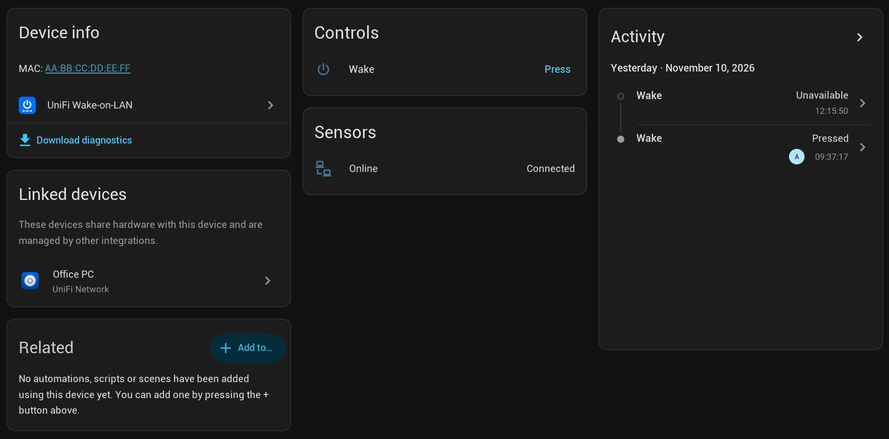
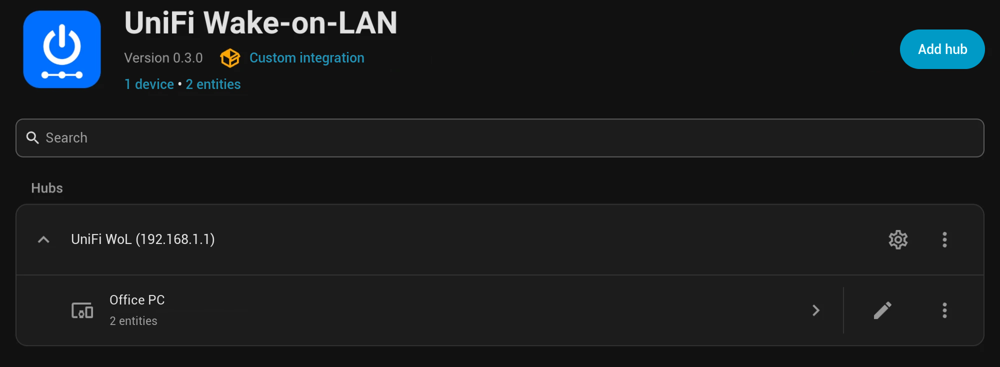

# UniFi Wake-on-LAN for Home Assistant

[](https://github.com/chriscomputerfreak/unifi-wake-on-lan/actions/workflows/validate.yml)
[](https://hacs.xyz)

*Deutsche Anleitung: [README.de.md](README.de.md)*

Wake clients **on any VLAN**. Instead of sending the magic packet from Home Assistant (which
only reaches its own broadcast domain), this integration lets your UniFi gateway send it
directly on the interface of the network the client was last seen in.

Tested with a **UniFi Cloud Gateway Fiber (UCG Fiber)**. It is meant for any UniFi OS gateway
(UCG Ultra/Max, UDM, UDM Pro/SE, UXG…).





## How it works

1. The UniFi Network API (read only) provides clients (active and history) and networks
   (subnet/VLAN).
2. When you press a button, the integration connects to the gateway via SSH, reads
   `ip -o -4 addr show` and picks the interface that serves the client's network (e.g. `br20`).
3. The packet is sent with the first tool available on the gateway:
   `etherwake` → `ether-wake` → `busybox ether-wake` → `python3` (raw Ethernet frame,
   EtherType 0x0842). If none of these exist, it falls back to a temporary static ARP entry
   plus a UDP packet to port 9 via `bash`; the entry is removed right away.

The UniFi API has no Wake-on-LAN command, which is why SSH is required.

## Installation

### HACS

[](https://my.home-assistant.io/redirect/hacs_repository/?owner=chriscomputerfreak&repository=unifi-wake-on-lan&category=integration)

Or add `https://github.com/chriscomputerfreak/unifi-wake-on-lan` as a custom repository
(type *Integration*), install **UniFi Wake-on-LAN** and restart Home Assistant.

### Manual

Copy `custom_components/unifi_wol` to `<config>/custom_components/` and restart Home Assistant.

## Configuration

Prerequisites on the gateway:

- A **local UniFi OS account** without 2FA. The *View Only* role is sufficient.
- **SSH enabled** in the UniFi OS console settings, with a password set. The user is `root`.

Then go to *Settings → Devices & services → Add integration → UniFi Wake-on-LAN*:

1. Controller: host (e.g. `192.168.1.1`), username, password and site (`default`). With
   *Verify SSL certificate* off (the default for the self-signed certificate), the
   certificate's fingerprint is pinned on first connect.
2. SSH: port `22`, user `root` and the SSH password. The SSH host key is pinned on first
   connect.
3. Open **Configure** and select the clients that should get a **Wake** button.
   ● online, ○ offline, 📶 Wi-Fi client (WoL rarely works over Wi-Fi).

### Changing the setup later

- **Reconfigure** (entry menu ⋮): change host, credentials, site or SSH settings. Your
  selected clients and entity IDs are kept; empty password fields keep the stored passwords.
- **Re-authenticate**: if the controller or the gateway rejects the stored credentials, Home
  Assistant asks for the new passwords.

## Usage

Each selected client gets two entities:

- **Wake** button. Its attributes show network, VLAN and last IP; after the first press also
  the interface and method that were used.
- **Online** sensor (connectivity), based on the UniFi client list. It is refreshed every
  5 minutes and additionally 30, 60 and 120 seconds after a wake, so you can see whether the
  client actually woke up. Note that UniFi may keep listing a client for a few minutes after
  it went to sleep.

The action also works for clients without a button:

```yaml
action: unifi_wol.wake
data:
  mac: "aa:bb:cc:dd:ee:ff"
  # interface: br20   # optional, overrides auto detection
  # wait: true          # optional, wait until the client is online
  # timeout: 120        # optional, seconds (10-600)
response_variable: result   # {mac, interface, method[, online]}
```

Example: wake the PC and only continue once it is reachable.

```yaml
- action: unifi_wol.wake
  data:
    mac: "aa:bb:cc:dd:ee:ff"
    wait: true
  response_variable: wake
- if: "{{ not wake.online }}"
  then:
    - action: notify.notify
      data:
        message: "The PC did not wake up."
```

## Troubleshooting

- Wake-on-LAN must be enabled in the BIOS/UEFI and in the network adapter. On Windows, also
  disable *Fast Startup*. Over Wi-Fi, WoL almost never works.
- A sleeping client is "offline" in UniFi. Its network and IP then come from the client history
  or from the data stored when you selected it.
- *Host key or certificate changed* (e.g. after a gateway reset): a repair appears under
  *Settings → Repairs*. It shows the stored and the new SHA256 fingerprints and stores the new
  ones only after you confirm. The same is available in the options ("Re-read and trust the
  SSH host key and certificate").
- **Download diagnostics** (entry menu ⋮) when opening an issue. Passwords and usernames are
  removed, MAC and IP addresses are shortened.
- Debug logging:
  ```yaml
  logger:
    logs:
      custom_components.unifi_wol: debug
  ```

## Security

The SSH password grants root access to your gateway. Like all integration credentials, it is
stored in `.storage/core.config_entries`. The integration only runs `ip -o -4 addr show` and
the wake script; all values are escaped with `shlex.quote`.

Both connections are pinned on first use: the SSH host key and, unless you enable CA
verification, the TLS certificate of the controller. A changed key or certificate is never
accepted silently. SSH keys are not supported on purpose: UniFi OS removes
`authorized_keys` on firmware updates.

## Disclaimer

This project is not affiliated with or endorsed by Ubiquiti Inc. UniFi is a trademark of
Ubiquiti Inc.

## License

[MIT](LICENSE)
